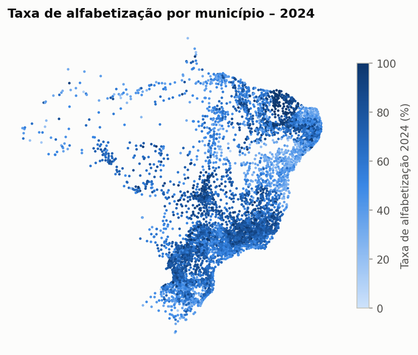
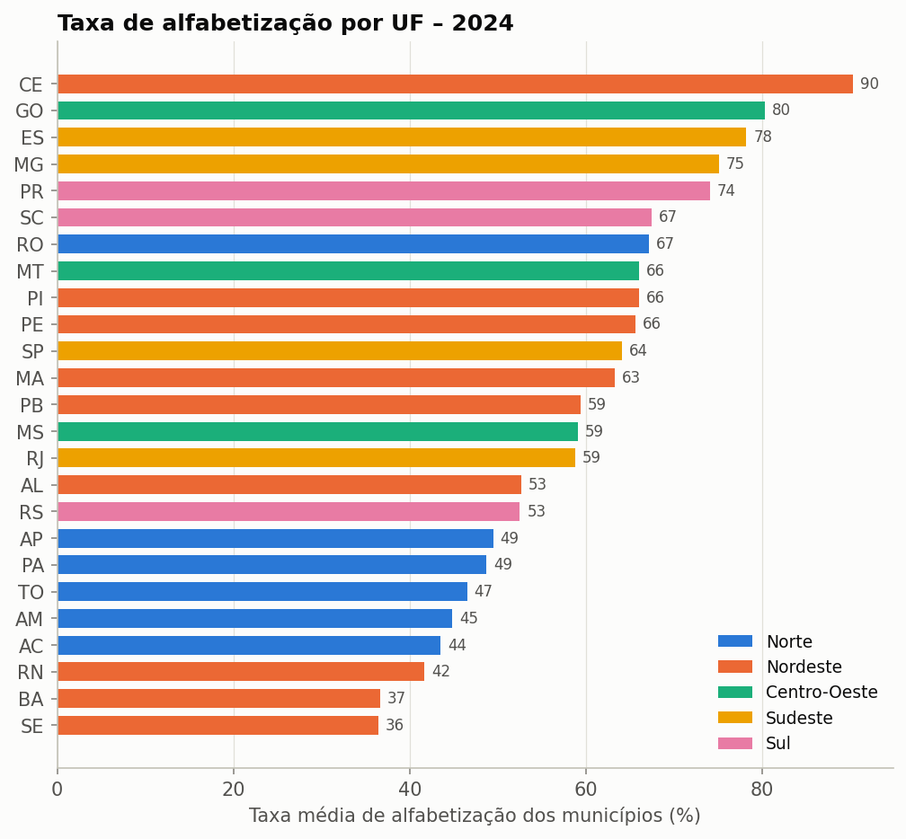
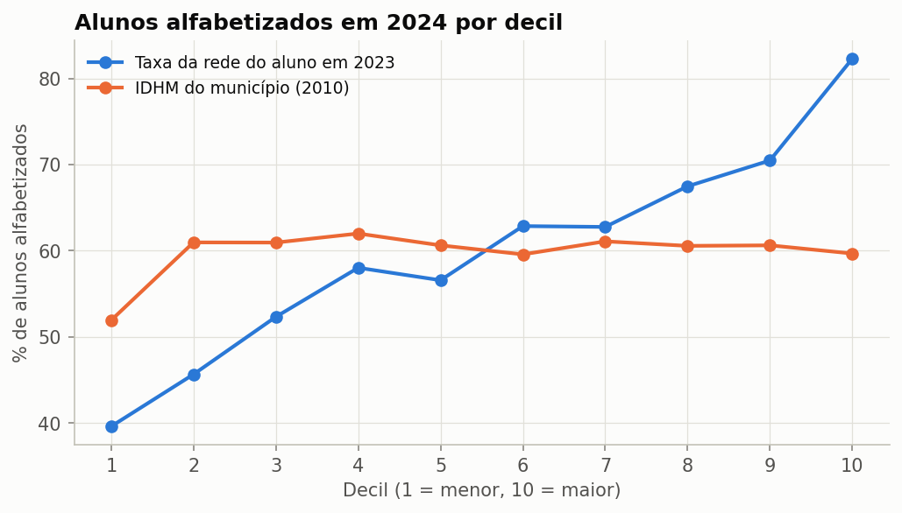
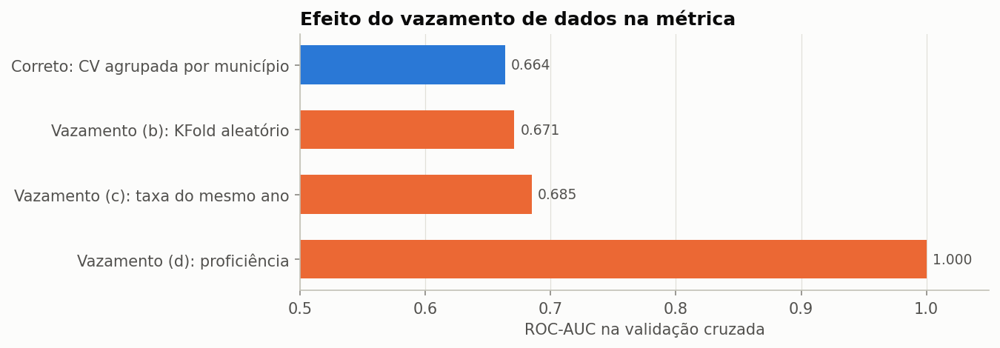
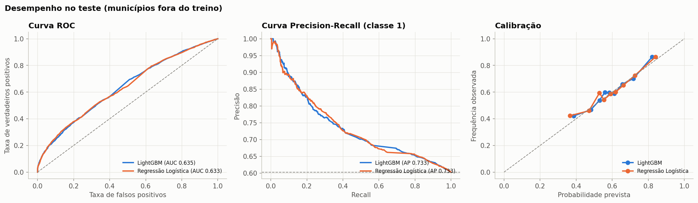
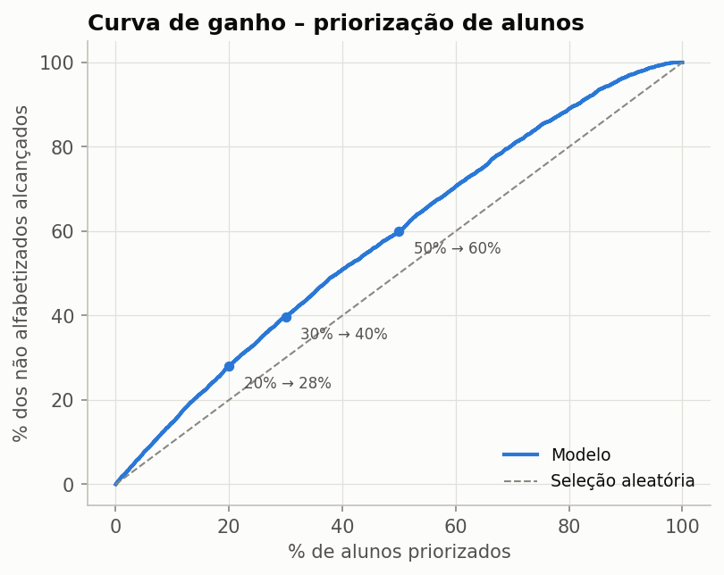
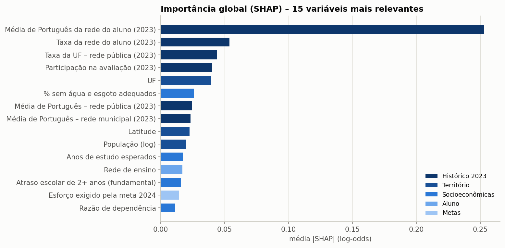
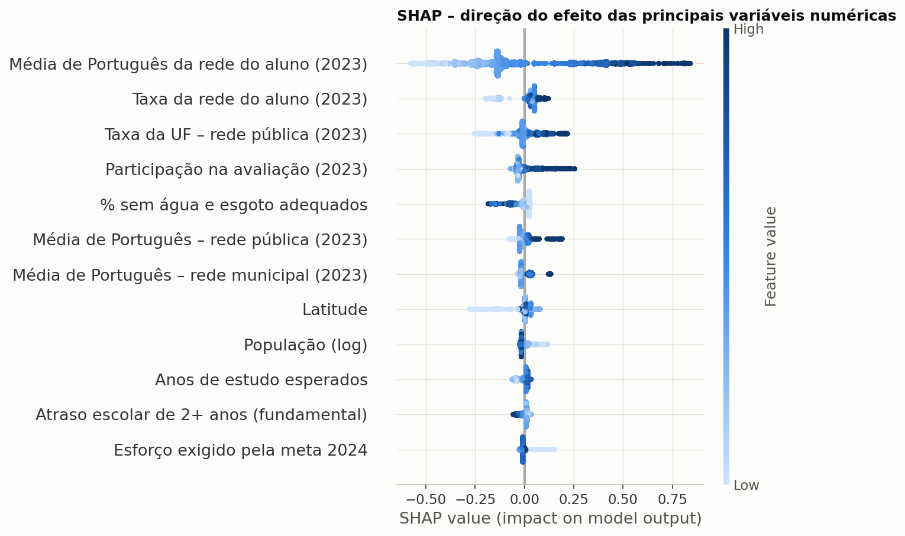
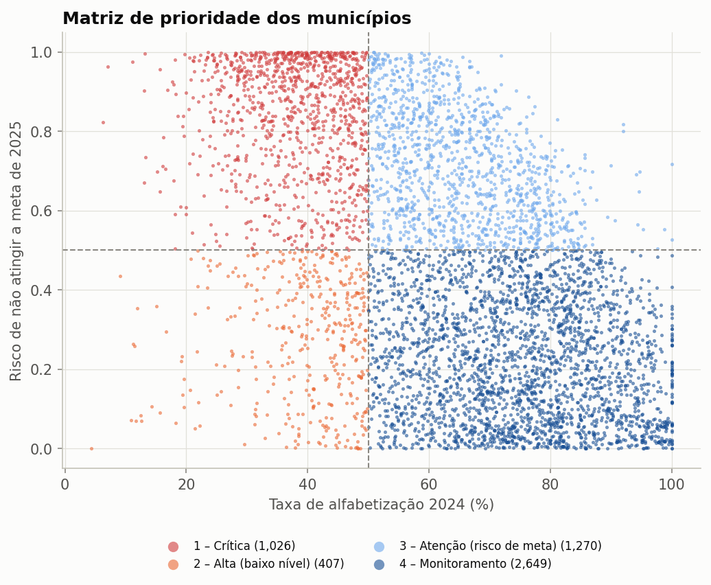
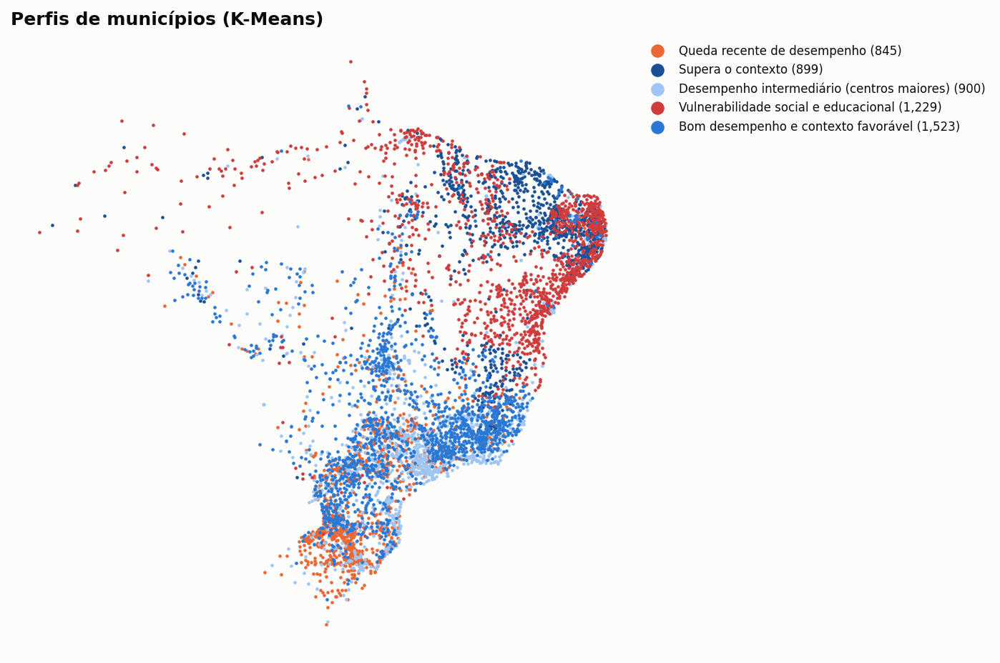

# Predição e Inteligência Analítica para Alfabetização no Brasil

Modelos de Machine Learning sobre os dados do **Indicador Criança Alfabetizada (INEP)** para
**antecipar onde está o risco de não alfabetização**, **entender o que mais se associa ao resultado** e
**apoiar a priorização de municípios** pela gestão pública.

<p align="center"></p>

---

## Resumo

| Pergunta | Resposta |
|---|---|
| É possível antecipar o risco de não alfabetização? | Sim, de forma **moderada**: ROC-AUC de 0,635 em municípios nunca vistos. O modelo prioriza redes e municípios: os 30% de maior risco reúnem 40% dos alunos não alfabetizados. |
| O que mais se associa à alfabetização? | O resultado anterior da rede de ensino e o contexto do estado. Os indicadores socioeconômicos pesam menos. |
| Quais municípios podem não atingir a meta de 2025? | O modelo municipal identifica quem fica abaixo da meta com ROC-AUC de 0,78 e prevê a taxa do ano seguinte com R² de 0,66. |
| Onde agir primeiro? | **1.026 municípios de prioridade crítica**: alfabetização abaixo de 50% e alta chance de não atingir a meta de 2025. |

> **Como ler este projeto:** o que foi observado nos dados de 2023 e 2024 é apresentado como fato.
> Explicações de causa e projeções para 2025 são **hipóteses e estimativas**, e estão sinalizadas como tal.

---

## Sumário
1. [Contexto do problema](#1-contexto-do-problema)
2. [Objetivo analítico](#2-objetivo-analítico)
3. [Base utilizada](#3-base-utilizada)
4. [Análise exploratória e hipóteses](#4-análise-exploratória-e-hipóteses)
5. [Etapas de modelagem](#5-etapas-de-modelagem)
6. [Escolha do algoritmo](#6-escolha-do-algoritmo)
7. [Métricas de avaliação](#7-métricas-de-avaliação)
8. [Interpretação dos resultados](#8-interpretação-dos-resultados)
9. [Insights encontrados](#9-insights-encontrados)
10. [Aplicação prática para políticas públicas](#10-aplicação-prática-para-políticas-públicas)
11. [Limitações](#11-limitações)
12. [Evoluções futuras](#12-evoluções-futuras)
13. [Como executar](#13-como-executar)
14. [Estrutura do repositório e versionamento](#14-estrutura-do-repositório-e-versionamento)

---

## 1. Contexto do problema

A alfabetização ao final do 2º ano do ensino fundamental é a base de toda a trajetória escolar. O
**Compromisso Nacional Criança Alfabetizada** definiu metas anuais por município, estado e país, com o
objetivo de alfabetizar **80% das crianças até 2030**. Em 2024, a rede pública brasileira alfabetizou
**59,2%** das crianças, abaixo da meta de 59,9%. Em 2025, chegou a **66%**, acima da meta de 64%.

As diferenças entre municípios são enormes: de menos de 10% a 100% de alunos alfabetizados. Conhecer o
resultado do ano anterior não basta. A gestão precisa **antecipar riscos**, **priorizar onde agir** e
**entender os fatores** associados a essas diferenças.

## 2. Objetivo analítico

| Pergunta de negócio | Abordagem |
|---|---|
| Um aluno será alfabetizado? | Classificação supervisionada com informações disponíveis antes da prova |
| Quais variáveis mais influenciam o modelo? Quais fatores mais se associam à alfabetização? | Importância nativa, importância por permutação e SHAP |
| Quais municípios podem não atingir as metas futuras? | Previsão da taxa do ano seguinte e probabilidade de ficar abaixo da meta |
| Quais municípios apresentam maior risco educacional? | Matriz de prioridade: nível atual × risco de não atingir a meta |
| Quais regiões possuem padrões semelhantes? | Agrupamento de municípios por perfil (K-Means) |

## 3. Base utilizada

### Camada Gold (reconstruída localmente)
A pipeline de dados original ([Literacy Data Pipeline](https://github.com/paollalopes/literacy-data-pipeline))
rodava em **Databricks + Spark + S3**. Para que este projeto possa ser reproduzido por qualquer pessoa,
as regras da Silver e da Gold foram reimplementadas em **pandas** (`src/preprocessing/gold.py`), a partir
dos mesmos seis CSVs originais do INEP. Os números reproduzem os da análise anterior: 5.232 municípios
com meta em 2024, dos quais 2.788 atingiram e 2.444 não.

| Tabela | Conteúdo |
|---|---|
| `gold_alunos` | 103.958 alunos (amostra de 2023 e 2024): rede, escola, caderno, presença, proficiência, alfabetizado |
| `gold_municipio_desempenho` | taxa da rede municipal, média de Português, participação, metas de 2024 a 2030 e status da meta |
| `gold_municipio_redes` | taxa e média por rede (estadual, municipal e pública) |
| `gold_uf_desempenho`, `gold_brasil_desempenho` | resultados e metas por UF e para o Brasil |
| `gold_municipio_evolucao` | variação de 2023 para 2024 |

> **Correção em relação à análise anterior:** o código de rede `5` estava rotulado como "Privada". Os
> dados mostram que ele é a rede **Pública**, que consolida a estadual e a municipal (ver notebook 01).

### Enriquecimento externo (`data/external/`)
| Fonte | Variáveis |
|---|---|
| **Atlas do Desenvolvimento Humano** (PNUD/IPEA/FJP, Censo 2010) | IDHM e subíndices, renda per capita, Gini, pobreza e extrema pobreza (inclusive de crianças), analfabetismo adulto, frequência à pré-escola, distorção idade-série, saneamento, energia, mortalidade infantil, formalização e desocupação |
| **IBGE** – censos e estimativas populacionais | população de 2010 a 2025, crescimento e porte |
| **IBGE** – relação de municípios | latitude, longitude e capital |

As fontes externas cobrem 100% dos municípios avaliados. O Atlas cobre 99,9%: ficam de fora os 5
municípios instalados em 2013, depois do Censo.

### Bases analíticas
| Base | Unidade | Alvo |
|---|---|---|
| `base_alunos_2024` | 49.651 alunos com avaliação válida em 2024, de 4.745 municípios | `alfabetizado` (59,8% = 1) |
| `base_municipios_2023` | 5.232 municípios com meta | não atingiu a meta de 2024 (46,7%) e taxa de 2024 |
| `base_municipios_2024` | 5.448 municípios | projeção para a meta de 2025 |

## 4. Análise exploratória e hipóteses

Notebook [`03_eda.ipynb`](notebooks/03_eda.ipynb). As hipóteses abaixo vêm de **associações observadas**
e orientaram a modelagem. Elas não comprovam causa.

| # | Hipótese | Evidência observada | Decisão de modelagem |
|---|---|---|---|
| H1 | O **estado** pesa mais que a renda | a UF explica 48% da variação entre municípios, e a região só 14%; os municípios do Ceará têm taxa média de 90%, com IDHM médio abaixo da média nacional (0,62 contra 0,66) | UF, região e taxa estadual do ano anterior como variáveis |
| H2 | O **resultado passado** ajuda a antecipar o futuro | r = 0,64 entre 2023 e 2024; entre os alunos das redes com pior resultado em 2023, 40% estavam alfabetizados em 2024, contra 82% nas melhores | indicadores **do ano anterior** |
| H3 | A socioeconomia importa, mas **de forma diferente em cada região** | associação fraca a moderada (\|ρ\| entre 0,2 e 0,3), com sinal que muda entre regiões | modelos de árvore, comparados com a Regressão Logística |
| H4 | A **versão da prova** não influencia o resultado | efeito desprezível (V de Cramér ≈ 0,025) | variável excluída |
| H5 | Resultados excepcionais **tendem a recuar** | 57% dos municípios muito acima da média estadual não atingiram a meta de 2024, contra 32% dos mais abaixo | posição em relação ao estado no modelo municipal |
| H6 | Municípios **pequenos são mais instáveis** | maior desvio padrão das taxas | incerteza por porte na projeção |

<p align="center">
 
</p>

## 5. Etapas de modelagem

Notebook [`04_modelagem.ipynb`](notebooks/04_modelagem.ipynb).

```text
base_alunos_2024
   │
   ├─ 20% dos MUNICÍPIOS reservados para o teste (GroupShuffleSplit) ───► teste (usado 1 vez)
   │
   └─ treino ─► StratifiedGroupKFold (5 partes, agrupado por município)
                 │
                 └─ Pipeline scikit-learn (ajustada dentro de cada parte)
                      1. AtributosDerivados   → engenharia de atributos
                      2. ColumnTransformer
                           numéricas: SimpleImputer(mediana, indicador de ausência) [+ StandardScaler]
                           categóricas: SimpleImputer(mais frequente) + OneHotEncoder
                      3. Modelo (Logística | Random Forest | HistGB | XGBoost | LightGBM)
```

**Engenharia de atributos:** taxa e média da rede do aluno no ano anterior, diferença entre as redes
estadual e municipal, presença de rede estadual, distância da rede para a média da UF, log da renda,
porte do município e esforço exigido pela meta.

**Tratamento de vazamento de dados (*data leakage*)**, o ponto mais crítico desta base:

| Risco | Tratamento |
|---|---|
| `alfabetizado` = (`proficiencia` ≥ 743) | proficiência e peso **excluídos** (com eles, a ROC-AUC chega a 1,00) |
| Alunos ausentes aparecem com `alfabetizado = 0` sem terem feito a prova | base restrita às **avaliações válidas** |
| A taxa municipal do mesmo ano inclui o próprio aluno | só indicadores **do ano anterior** (2023) |
| Alunos do mesmo município no treino e no teste | divisão e validação **por município** |
| Imputação, padronização e One-Hot ajustados na base toda | tudo **dentro da pipeline**, ajustado em cada parte da validação |
| Limiar escolhido olhando o teste | limiar escolhido com previsões fora da amostra do treino |

<p align="center"></p>

**Otimização:** `RandomizedSearchCV` (20 combinações × 5 partes por município), com busca focada em
parâmetros que controlam overfitting (mínimo de alunos por folha, número de folhas, subamostragem e
regularização L1/L2).
**Generalização:** diferença entre treino e validação de cerca de 0,02 no modelo otimizado, intervalo de
confiança por bootstrap de municípios, avaliação por região e repetição com outras 4 divisões.

## 6. Escolha do algoritmo

| Modelo | Algoritmo | Por quê |
|---|---|---|
| **Alunos** (classificação) | **LightGBM** | Os cinco algoritmos empatam na prática (diferenças menores que a variação entre as partes da validação). O LightGBM foi escolhido porque capta interações sem precisar especificá-las, como a relação com o IDHM que muda entre regiões, e permite calcular o SHAP de forma exata. A Regressão Logística fica como referência mais simples de explicar. |
| **Municípios** (risco de meta) | **LightGBM regressor + probabilidade** | Prevê a taxa do ano seguinte e calcula P(taxa < meta) com a incerteza de cada porte. A meta não entra como variável, então o modelo funciona para qualquer meta futura sem extrapolar. Um classificador direto ficaria fora da faixa de treino em 35% dos municípios. |
| **Perfis** | **K-Means (k = 5)** | Perfis interpretáveis e acionáveis; k escolhido pelo cotovelo da inércia e pela silhueta. |

## 7. Métricas de avaliação

### Modelo de alunos (teste com municípios nunca vistos)
| Métrica | Valor |
|---|---|
| ROC-AUC na validação cruzada | **0,664 ± 0,010** |
| ROC-AUC no teste | **0,635** (IC 95%: 0,61 a 0,66) |
| ROC-AUC em outras 4 divisões de municípios | de 0,635 a 0,672 (média de 0,655) |
| Teto de referência (com vazamento, usando o resultado do próprio ano) | 0,685 |
| Priorização | os 30% de maior risco reúnem **40%** dos não alfabetizados (30% ao acaso) |
| Limiar de 0,70 | alcança 90% dos não alfabetizados, mas sinaliza **82% de todos os alunos** (precisão de 44%) |

<p align="center"></p>

> **Por que a ROC-AUC é moderada:** as variáveis disponíveis antes da prova descrevem a **rede e o
> município**, não a criança. Por isso, alunos da mesma rede no mesmo município recebem a mesma
> probabilidade. Mesmo conhecendo o resultado final do município, a ROC-AUC chegaria a 0,685. O restante
> provavelmente depende de informações individuais (família, turma, frequência), que não existem na base.

**Por isso, a recomendação de uso é a ordenação por risco**, com o corte definido pela capacidade de
atendimento, e não um limiar fixo.

<p align="center"></p>

### Modelo de risco de meta (municípios fora do treino)
| Métrica | Valor |
|---|---|
| ROC-AUC (não atingir a meta) | **0,78** (IC 95%: 0,75 a 0,81) |
| R² da taxa do ano seguinte | **0,66** (contra 0,32 de "repetir a taxa atual") |
| Erro médio (MAE) da taxa do ano seguinte | 8,3 pontos percentuais |
| Checagem de ordem de grandeza: média prevista para 2025 × resultado nacional de 2025 | **67,1% × 66,0%** |

A checagem de 2025 é um indício, não uma validação: as duas médias medem coisas diferentes (a nacional é
ponderada pelo número de alunos e inclui a rede estadual), e o resultado de 2025 por município ainda não
está disponível.

## 8. Interpretação dos resultados

Notebook [`05_interpretabilidade.ipynb`](notebooks/05_interpretabilidade.ipynb).

<p align="center"> </p>

As três técnicas (importância nativa, permutação e SHAP) e os coeficientes da Regressão Logística apontam
na mesma direção:

1. **Histórico de 2023 da rede do aluno.** A variável mais influente é a média de Português da rede do
   aluno no município. Embaralhar o grupo de histórico derruba a ROC-AUC em 0,09.
2. **Contexto estadual:** o resultado da UF em 2023 e o efeito da própria UF (queda de 0,02 na ROC-AUC
   quando o território é embaralhado).
3. **Participação na avaliação:** redes com participação alta tiveram, em média, alunos com maior
   probabilidade de alfabetização.
4. **Socioeconomia, com peso menor:** saneamento, distorção idade-série e escolaridade esperada. O IDHM
   quase não é usado depois que o histórico entra no modelo.

O efeito de UF mais forte é o do **Rio Grande do Sul, negativo**: a taxa do estado caiu de 63% para 45%
entre 2023 e 2024, queda que **coincide** com as enchentes de abril e maio de 2024.

> As importâncias e o SHAP descrevem o que o modelo usa para prever. São **associações, não efeitos
> causais**: indicam onde investigar, mas não comprovam o impacto de uma política.

## 9. Insights encontrados

- **O resultado anterior da rede é o fator mais associado à alfabetização**, acima da renda. Onde a rede
  já alfabetizava bem, os alunos tiveram chance muito maior de se alfabetizar. Uma hipótese é que fatores
  de gestão pedagógica, que mudam devagar, ficam registrados nesse histórico.
- **As diferenças entre estados não acompanham a riqueza.** Os municípios do Ceará têm taxa média de 90%
  com IDHM abaixo da média nacional, o que é compatível com o papel de políticas estaduais de alfabetização.
- **899 municípios "superam o contexto"** (80% no Nordeste): IDHM baixo e pobreza alta, mas alfabetização
  mediana de 77% e em alta. São os casos que mais sugerem que gestão e política educacional podem
  compensar o contexto, e uma referência para troca de práticas.
- **Choques externos podem reverter o avanço rapidamente.** A taxa do RS caiu quase 19 pontos em um ano, e
  nenhum modelo treinado com dados de 2023 antecipou essa queda.
- **Resultados excepcionais tendem a recuar.** Municípios muito acima da média do estado deixaram de
  atingir a meta com mais frequência, sobretudo os pequenos, que são mais instáveis.
- **Municípios maiores alfabetizaram menos:** 52,7% nos com mais de 500 mil habitantes, contra 67,5% nos
  com até 5 mil.

## 10. Aplicação prática para políticas públicas

Notebook [`06_aplicacao_estrategica.ipynb`](notebooks/06_aplicacao_estrategica.ipynb).

<p align="center"> </p>

| Prioridade | Municípios | Situação | Ação sugerida |
|---|---|---|---|
| 1 – Crítica | **1.026** (BA 336, RS 187, RN 75, PA 71…) | taxa abaixo de 50% **e** risco de 50% ou mais | intervenção imediata e acompanhamento intensivo |
| 2 – Alta | 407 | taxa abaixo de 50%, risco menor | apoio estruturante (formação, material, gestão) |
| 3 – Atenção | 1.270 | taxa adequada, risco alto | monitorar a sustentação do resultado |
| 4 – Monitoramento | 2.649 | taxa adequada, risco baixo | manter e disseminar boas práticas |

Os cortes de 50% são **critérios de gestão**, não resultados do modelo, e podem ser ajustados à
capacidade de atendimento.

**Como usar:**
1. **Início do ano letivo:** aplicar o modelo de alunos aos resultados do ano anterior para ordenar
   **redes e municípios** por risco e definir onde concentrar o reforço, conforme a capacidade de
   atendimento.
2. **Planejamento estadual:** usar `reports/ranking_prioridade_municipios_2025.csv` para direcionar apoio
   técnico e financeiro aos municípios críticos.
3. **Troca de experiências:** conectar municípios do perfil "Vulnerabilidade social e educacional" a
   municípios que "superam o contexto" com perfil socioeconômico parecido.
4. **Resposta a choques:** encaminhar os municípios com "Queda recente de desempenho" a programas de
   recomposição de aprendizagem.
5. **Painéis:** `reports/municipios_risco_perfil_2025.csv` está pronto para Power BI ou Looker, com
   coordenadas.

## 11. Limitações

- **O modelo de alunos prioriza redes, não crianças.** As variáveis descrevem o município e a rede, então
  alunos da mesma rede no mesmo município recebem a mesma probabilidade.
- **Amostra de alunos:** a base é uma amostra, com cerca de 2 alunos por escola. Não permite indicadores
  confiáveis por escola nem variáveis individuais (família, frequência, turma).
- **Socioeconomia de 2010:** o Atlas municipal mais recente com todos os indicadores é do Censo 2010. Ele
  entra como proxy estrutural e deve ser substituído pelos indicadores do Censo 2022 quando publicados
  por município.
- **Apenas dois anos de avaliação:** há uma única transição (2023 → 2024) para treinar o modelo
  municipal, e ela inclui o choque do RS. A validação temporal fica limitada.
- **Choques imprevisíveis:** eventos como enchentes ou pandemias não podem ser antecipados com dados
  históricos.
- **Projeções são estimativas:** o risco de 2025 supõe erros com distribuição aproximadamente normal e
  depende da dinâmica observada em um único ano.
- **Associação não é causa:** importâncias, SHAP e perfis indicam onde investigar, mas não comprovam o
  efeito de políticas.
- **Instabilidade dos municípios pequenos:** com poucas crianças avaliadas, as taxas oscilam muito (erro de
  cerca de 15 pontos nos menores). O risco calculado incorpora isso, mas a incerteza individual é alta.

## 12. Evoluções futuras

- Incorporar **Censo Escolar** (infraestrutura, formação docente, alunos por turma, tempo integral),
  **FUNDEB/VAAR** e **Cadastro Único**, e substituir o Atlas 2010 pelos indicadores do Censo 2022.
- Com mais anos de avaliação: **validação temporal** (treinar em um ano e testar no seguinte) e modelos de
  painel.
- Modelos **multinível** (aluno ⊂ escola ⊂ município ⊂ UF) e **inferência causal** (por exemplo, diferenças
  em diferenças para avaliar programas estaduais).
- **Monitoramento de drift** e retreino anual automatizado (MLflow), com o modelo disponível via API e
  painel para as secretarias.
- **Análise de equidade:** desempenho e calibração por grupos (raça/cor, nível socioeconômico, zona rural).

## 13. Como executar

Requisitos: Python 3.11 ou superior.

```bash
git clone https://github.com/paollalopes/modelo_supervisionado_alfabetizacao.git
cd modelo_supervisionado_alfabetizacao
python -m venv .venv
.venv\Scripts\activate            # Windows  (Linux/Mac: source .venv/bin/activate)
pip install -r requirements.txt

# Opção 1 – executar toda a pipeline (os seis notebooks, em ordem)
python executar_pipeline.py
python executar_pipeline.py --a-partir 4   # recomeça a partir do notebook 04

# Opção 2 – explorar interativamente
jupyter lab                        # executar notebooks/01 → 06, em ordem
```

Os dados brutos (`data/raw`) e externos (`data/external`) estão versionados. As bases processadas
(`data/processed`) e os modelos (`models/`) são gerados pela execução. Todas as etapas usam
`RANDOM_STATE = 42`. Tempo total: cerca de 11 minutos numa máquina com 2 núcleos; a otimização de
hiperparâmetros é a etapa mais longa.

| Notebook | Conteúdo |
|---|---|
| `01_gold_local` | Bronze → Silver → Gold em pandas e conferência com a análise anterior |
| `02_enriquecimento_bases` | Fontes externas e bases analíticas (sem vazamento de dados) |
| `03_eda` | Análise exploratória e hipóteses |
| `04_modelagem` | Pipeline, comparação de algoritmos, vazamento, ablação, otimização e avaliação |
| `05_interpretabilidade` | Importância nativa, importância por permutação e SHAP |
| `06_aplicacao_estrategica` | Risco da meta de 2025, prioridades e perfis de municípios |

## 14. Estrutura do repositório e versionamento

```text
modelo_supervisionado_alfabetizacao
├── data
│   ├── external/         # IBGE e Atlas do Desenvolvimento Humano
│   ├── processed/        # Gold e bases analíticas (geradas pela execução)
│   └── raw/              # 6 CSVs originais do INEP
├── images/               # figuras do README e dos notebooks
├── models/               # modelos treinados (gerados pela execução, .joblib)
├── notebooks/            # 01 → 06, executados e com saídas
├── reports/              # métricas, rankings, metadados dos modelos e documentação técnica
├── src
│   ├── evaluation/       # metrics.py
│   ├── modeling/         # pipeline.py, train.py, municipios.py
│   ├── preprocessing/    # gold.py, external.py, features.py
│   ├── visualization/    # style.py (paleta) e rotulos.py (nomes legíveis das variáveis)
│   └── config.py         # caminhos, semente e constantes de negócio
├── executar_pipeline.py  # executa os notebooks 01 → 06 em ordem
├── README.md
└── requirements.txt
```

**Versionamento:** cada etapa foi desenvolvida numa *branch* própria e integrada à `main` por *pull
request*, com commits no padrão *Conventional Commits* (`feat`, `fix`, `docs`, `chore`, `style`, `data`):

| Etapa | Branch |
|---|---|
| Estrutura e camada Gold | `feature/01-estrutura-gold` e `fix/01-revisao-gold` |
| Enriquecimento e bases analíticas | `feature/02-enriquecimento-externo` |
| Análise exploratória | `feature/03-eda` |
| Modelagem | `feature/04-modelagem` |
| Interpretabilidade | `feature/05-interpretabilidade` |
| Aplicação estratégica | `feature/06-aplicacao-estrategica` |
| Documentação | `feature/07-documentacao` |

As decisões analíticas estão documentadas nos próprios notebooks e em
[`reports/documentacao_tecnica.md`](reports/documentacao_tecnica.md).

---

**Fontes de dados:** INEP – Indicador Criança Alfabetizada; PNUD/IPEA/FJP – Atlas do Desenvolvimento
Humano no Brasil; IBGE – Censos Demográficos, estimativas populacionais e relação de municípios.
